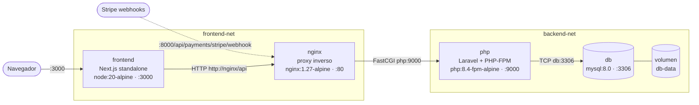

# E-commerce contenerizado: Next.js + Laravel + MySQL

Ecosistema de producción de una tienda en línea formado por tres servicios desarrollados durante el bootcamp:

| Servicio | Tecnología | Carpeta |
|---|---|---|
| Frontend | Next.js 16 (App Router, React 19, Tailwind 4, Stripe Elements) | [`frontend/`](frontend) |
| API REST | Laravel 13 sobre PHP-FPM 8.4 + Nginx (JWT, Stripe, Swagger) | [`backend/`](backend) |
| Base de datos | MySQL 8.0 | [`mysql/`](mysql) |

Cada imagen se construye con **builds multi-stage** para separar la compilación de la ejecución. Así las imágenes quedan ligeras, sin herramientas de build ni secretos, con usuarios sin privilegios, y aprovechan la caché de capas de Docker. Todo se levanta con un solo `docker compose up`.

> Los dos proyectos se importaron con `git subtree`, que conserva el historial original de commits de cada uno.

---

## Arquitectura de contenedores



- **Dos redes aisladas**. `frontend-net` une `frontend` ↔ `nginx` y `backend-net` une `nginx` ↔ `php` ↔ `db`. El frontend **no puede** resolver ni alcanzar la base de datos.
- **Puertos publicados en el host**: solo `3000` (frontend) y `8000` (API). PHP-FPM (`9000`) y MySQL (`3306`) quedan internos.
- **El frontend llama a la API desde el servidor** (Server Components y Server Actions) por la red interna (`API_BASE_URL=http://nginx/api`). El token JWT nunca llega al navegador.
- **Orden de arranque garantizado** con `healthcheck` + `depends_on: condition: service_healthy`: `db` → `php` (ejecuta migraciones) → `nginx` → `frontend`.

```
.
├── docker-compose.yml        # orquestación de los 4 contenedores
├── .env.example              # variables documentadas
├── mysql/init/01-init.sql    # script de inicialización (docker-entrypoint-initdb.d)
├── frontend/
│   ├── Dockerfile            # deps → builder → runner
│   └── .dockerignore
└── backend/
    ├── Dockerfile            # base → vendor → php | nginx
    ├── .dockerignore
    └── docker/
        ├── entrypoint.sh     # cachés de Laravel + migraciones
        ├── php/php.ini       # ajustes de producción + OPcache
        └── nginx/default.conf
```

---

## Ejecución

### Requisitos
- Docker Engine 24+ con Docker Compose v2 (o Docker Desktop).

### 1. Configurar variables

```bash
cp .env.example .env
```

Completa en `.env`:

| Variable | Cómo obtenerla |
|---|---|
| `APP_KEY` | `docker compose build php` y luego `docker compose run --rm --no-deps --entrypoint php php artisan key:generate --show` |
| `JWT_SECRET` | `openssl rand -base64 48` |
| `DB_PASSWORD`, `MYSQL_ROOT_PASSWORD` | Contraseñas seguras, distintas entre sí |
| `STRIPE_*`, `NEXT_PUBLIC_STRIPE_PUBLISHABLE_KEY` | Panel de Stripe en modo test (opcionales; sin ellas todo funciona excepto el pago) |

### 2. Levantar el ecosistema

```bash
docker compose up -d --build
```

```bash
docker compose ps      # los 4 servicios deben quedar "healthy"
docker compose logs -f php
```

### 3. Acceder

| URL | Descripción |
|---|---|
| http://localhost:3000 | Tienda (redirige a `/products`) |
| http://localhost:8000/api/products | API REST |
| http://localhost:8000/api/documentation | Documentación Swagger |
| http://localhost:8000/up | Health check de Laravel |

### 4. Datos iniciales

La base de datos arranca vacía; las migraciones se ejecutan solas al iniciar el contenedor `php`. Para cargar el catálogo:

1. Crea una cuenta desde http://localhost:3000/register (o con `POST /api/register`).
2. Conviértela en administrador:
   ```bash
   docker compose exec php php artisan tinker --execute 'App\Models\User::where("email","tu@correo.com")->update(["role"=>"admin"]);'
   ```
3. Inicia sesión (`POST /api/login`) y crea productos con `POST /api/products` usando el token, o desde Swagger con **Authorize**.

### Comandos útiles

```bash
docker compose down            # detiene y elimina contenedores (los datos persisten en el volumen)
docker compose down -v         # además borra el volumen de MySQL
docker compose exec php php artisan migrate:status
docker compose exec db sh -c 'mysql -u"$MYSQL_USER" -p"$MYSQL_PASSWORD" "$MYSQL_DATABASE"'
```

> **Nota.** La cookie de sesión del frontend se marca `Secure` en producción. Los navegadores la aceptan en `http://localhost`, pero si despliegas en otro host debes servir el frontend por HTTPS.

---

## Decisiones técnicas

### Frontend — [`frontend/Dockerfile`](frontend/Dockerfile)

| Etapa | Base | Qué hace |
|---|---|---|
| `deps` | `node:20-alpine` | Copia **solo** `package.json` + `package-lock.json` y ejecuta `npm ci` |
| `builder` | `node:20-alpine` | Copia `node_modules` + código y ejecuta `next build` |
| `runner` | `node:20-alpine` | Imagen final: servidor standalone + `.next/static` + `public` |

- **`output: "standalone"`** en `next.config.ts`. `next build` traza qué archivos de `node_modules` usa realmente la app y genera `server.js`, el mismo servidor de producción que usa `next start`. La imagen final no contiene `node_modules` completos, ni el código fuente, ni TypeScript, ESLint o Tailwind.
- **Orden de capas pensado para la caché**. Los manifiestos se copian antes que el código, así que mientras `package-lock.json` no cambie, `npm ci` sale de la caché y solo se recompila la app.
- **`RUN --mount=type=cache`** conserva la caché de npm entre builds sin guardarla en la imagen.
- **`NEXT_PUBLIC_STRIPE_PUBLISHABLE_KEY` como `ARG`**. Next incrusta las variables `NEXT_PUBLIC_*` en el bundle del navegador durante el build. `API_BASE_URL`, en cambio, solo la lee el servidor, por eso se inyecta en runtime.
- **Usuario no-root** `nextjs` (uid 1001), `NEXT_TELEMETRY_DISABLED=1` y `HEALTHCHECK` con `wget`, que ya viene en busybox, así que no hace falta instalar curl.
- **`.dockerignore`** excluye `node_modules`, `.next`, `.env*`, `.git` y `docs` para que el contexto de build sea pequeño y ningún secreto acabe en una capa.

### Backend — [`backend/Dockerfile`](backend/Dockerfile)

Un solo Dockerfile con cuatro etapas y **dos imágenes finales** (targets `php` y `nginx`):

| Etapa | Base | Qué hace |
|---|---|---|
| `base` | `php:8.4-fpm-alpine` | Compila `pdo_mysql` y `opcache` y aplica la configuración de producción |
| `vendor` | `base` + Composer | `composer install --no-dev` y autoloader optimizado |
| `php` (target) | `base` | Código + **solo `vendor/`** copiado de la etapa anterior |
| `nginx` (target) | `nginx:1.27-alpine` | Proxy inverso con solo `public/` y su configuración |

- **PHP 8.4 en lugar de 8.2**. Laravel 13 exige `php ^8.3`, y el `composer.lock` incluye Symfony 8, que requiere PHP ≥ 8.4.1. Se eligió la versión mínima que cumple el lock sin cambiar dependencias; sigue cumpliendo el requisito de PHP 8.2+.
- **Extensiones**. `mbstring`, `openssl`, `tokenizer`, `xml`, `ctype` y `json` ya vienen compiladas en la imagen oficial, así que solo se compilan `pdo_mysql` y `opcache`. Las herramientas de compilación (`$PHPIZE_DEPS`) se instalan como paquete virtual y se eliminan **en la misma capa**, de modo que no ocupan espacio en la imagen. Puedes comprobarlo con `docker compose exec php php -m`.
- **Composer solo en la etapa de build**. Se copia desde la imagen oficial `composer:2` y nunca llega a la imagen final. Primero se instalan las dependencias con solo `composer.json/lock` (`--no-autoloader --no-scripts`), una capa lenta que se reutiliza mientras el lock no cambie. Después se copia el código y se genera un autoloader `--classmap-authoritative`.
- **Sin paquetes de desarrollo**. `--no-dev` excluye Pest, Mockery, Faker, Pint y Boost. El `.dockerignore` excluye además `bootstrap/cache/*.php` local, que registraba providers de esos paquetes, y `package:discover` se regenera dentro de la imagen.
- **Nginx y PHP-FPM en contenedores separados**: un proceso por contenedor, escalado y logs independientes. Nginx no necesita el código PHP, solo `public/`, y envía cada petición por FastCGI a `php:9000`. Se ocultan versiones (`server_tokens off`, `expose_php = Off`, `fastcgi_hide_header X-Powered-By`), se bloquean archivos ocultos y otros `.php`, y se añaden cabeceras de seguridad.
- **OPcache con `validate_timestamps=0`**. El código es inmutable dentro de la imagen, así que no hace falta revisar en cada petición si los archivos cambiaron.
- **`entrypoint.sh`** genera `config:cache`, `route:cache` y `view:cache` al arrancar, porque dependen de las variables de entorno, y ejecuta `migrate --force`. Si faltan `APP_KEY` o `JWT_SECRET`, falla con un mensaje claro.
- **Configuración por variables de entorno**. El `.env` del proyecto no se copia a la imagen, y los logs van a `stderr` (`LOG_CHANNEL=stderr`), así que se consultan con `docker compose logs`.
- **Usuario `www-data`** en runtime, con permisos de escritura solo en `storage/` y `bootstrap/cache/`.
- **No se incluye etapa Node** para los assets de Vite, porque la API no sirve vistas: `welcome.blade.php` solo carga Vite si existe el manifest.

### Base de datos — `mysql:8.0`

- Imagen oficial configurada con `MYSQL_ROOT_PASSWORD`, `MYSQL_DATABASE`, `MYSQL_USER` y `MYSQL_PASSWORD`. La API se conecta con el usuario de la aplicación, no con root.
- Volumen nombrado `db-data` en `/var/lib/mysql`: los datos sobreviven a `docker compose down`.
- `mysql/init/01-init.sql` se monta en `/docker-entrypoint-initdb.d/` (solo lectura) y fija `utf8mb4_unicode_ci`, igual que `config/database.php`. Las tablas las crean las migraciones de Laravel.
- **Sin `ports`**. El puerto 3306 solo es accesible dentro de `backend-net`.
- `healthcheck` con `mysqladmin ping`, para que la API no arranque antes de que MySQL acepte conexiones.

### Resultados medidos

| Imagen | Tamaño en disco | Descarga (comprimida) | Referencia sin multi-stage |
|---|---|---|---|
| `ecommerce-frontend` | 291 MB | ~70 MB | 1.2 GB (etapa `builder`): **−76 %** |
| `ecommerce-api-php` | 208 MB | ~43 MB | 214 MB (etapa `vendor`, con Composer y unzip) |
| `ecommerce-api-nginx` | 74 MB | ~20 MB | — |

Al cambiar solo el código fuente y reconstruir, las capas de `npm ci`, `composer install` y la compilación de extensiones salen `CACHED`; solo se repite el `next build` y la copia del código.
